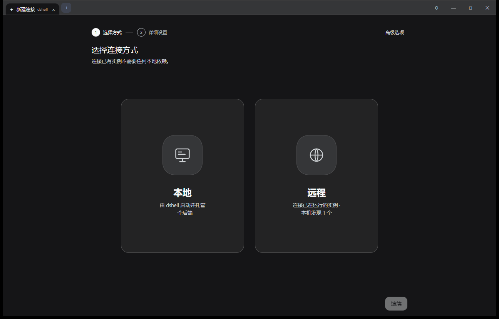

<div align="center">
  
  <h1>dshell</h1>
  <p><b>A desktop shell for DeepSeek Harness</b><br>
  One binary, one window, as many native DSH tabs as you need.</p>
  <p>
    <a href="../LICENSE"></a>
    
    
    
  </p>
  <p><a href="../README.md">简体中文</a> · English</p>
  <p>💙 Built on <a href="https://github.com/deepseek-ai/deepseek-harness">DeepSeek Harness</a>:
  the UI, the sessions and the whale are all DSH — dshell only adds a window around them.</p>
</div>

---



<p align="center"><sub><b>New connection</b> — let dshell start a local backend, or attach to a DSH instance that is already running.</sub></p>

## Why

`dsh web` is already a complete web app; what it lacks is a decent desktop window. dshell is that window, and nothing more:

- It does **not** rewrite DSH's chat, sessions, approvals or terminal — every tab loads the official frontend.
- It does **not** inject scripts or patch DSH, so a DSH upgrade never has to wait for dshell.
- It is **not another client** — no agent logic of its own, and it never touches model credentials.

dshell only does three things: **start or attach `dsh web`, capture the launch token, and arrange instances as tabs**.

## Features

- **One binary** — a single `dshell.exe` (~4 MB). Copy it and run; no installer, no bundled Node.
- **One window, many sessions** — each tab is an independent DSH instance (locally started or remotely attached). Sessions, approvals and terminals stay independent. Closing a tab ends its backend by default; the advanced options can keep it alive.
- **100% native UI** — no rewrite, no injection; the tab is DSH itself.
- **Credentials never pass through dshell** — the launch token appears in memory once, then the webview redeems and holds the cookie itself.
- **Connection first** — attaching to a local or remote instance needs no Node. dshell scans for instances already running on this machine, remembers recent connections, and lets you pin the ones you use.
- **Browser-style tabs** — `Ctrl+T` new, `Ctrl+W` close, `Ctrl+Tab` cycle, drag to reorder, double-click to rename, middle-click to close.
- **The window comes back** — position, size and maximized state are remembered between runs, and the window reopens at the same spot on the same monitor. A resolution change, a rearranged desktop or an unplugged second screen still puts it fully on screen.
- **DSH version check on restart** — a restored local npx tab checks for a newer DSH before its backend starts. Choose *ask every time*, *keep the old version* or *update to the new version*; the prompt's "remember" checkbox writes that setting, which you can change at any time. Source checkouts and the other runtimes are unaffected.
- **Follows the DSH theme** — the tab strip switches between light and dark with the active DSH page.
- **Your data stays yours** — dshell's config, runtimes and webview storage live in one data root; `DSH_HOME` is left untouched by default, so existing history, settings and API keys keep working.

> By default, DSH content pages ignore Windows' "reduce motion" setting so that
> working indicators such as the in-progress ring keep animating (dshell's own
> pages still follow the system setting). Turn this off in **Settings →
> Preferences → Keep DSH content animations playing**. New tabs pick up the
> change immediately; open tabs update after restarting dshell.

## Getting started

### Run it

Get the package for your platform from [Releases](https://github.com/Sturmfy/dshell/releases) — or [build it from source](#build-from-source):

| Platform | Artifact | Notes |
|---|---|---|
| Windows 10/11 | `dshell-<version>-windows-x64.exe` | single file; WebView2 Runtime required (usually present) |
| Linux x86_64 | `dshell-<version>-linux-x86_64.AppImage` | single-file AppImage; WebKitGTK 4.1 required |
| macOS 11+ | `dshell-<version>-macos-universal.dmg` | universal; unsigned builds need right-click → Open, or `xattr -dr com.apple.quarantine` |

The first launch opens a wizard: choose a data location → check the environment → create a connection.

Attaching needs no Node; only "start local" via npx does. Platform dependencies and known gaps are in [docs/platforms.md](platforms.md).

> The in-app UI is currently in Simplified Chinese. This English README documents the same application.

### Where dshell keeps its data

The data root has a four-level fallback; the settings page always shows which level won:

| Priority | Location |
|---|---|
| 1 | `--data-root <path>` |
| 2 | `$DSHELL_HOME` |
| 3 | `dshell-data/` next to the executable (next to the `.app` on macOS) |
| 4 | `%LOCALAPPDATA%\dshell` / `~/.local/share/dshell` / `~/Library/Application Support/dshell` |

This holds dshell's config, downloaded runtimes and per-instance webview storage. DSH's own `~/.dsh` (sessions, settings, credentials) is untouched by default.

### Build from source

Rust ≥ 1.90, Node ≥ 20 (build only), and the platform's web engine (WebView2 on Windows, WebKitGTK on Linux, WebKit on macOS).

```powershell
npm install           # esbuild / typescript / @tauri-apps/api
npm run build         # Windows: build the UI + release binary
npm run binary        # Windows: stage release/dshell.exe and assert it is a single file
npm run bundle:linux  # Linux: build the AppImage
npm run bundle:mac    # macOS: build the universal .app + .dmg
npm run app           # run in development mode
npm test              # Rust unit tests
npm run check         # clippy -D warnings
npm run icons         # logo-tile.svg → PNG → icon.ico (needs local Chrome/Edge)
```

Linux also needs Tauri's system packages (`libwebkit2gtk-4.1-dev`, `libgtk-3-dev`, `libayatana-appindicator3-dev`, …), listed in [docs/platforms.md](platforms.md).

### Keyboard shortcuts

| Shortcut | Action |
|---|---|
| `Ctrl+T` | New connection |
| `Ctrl+W` | Close the current tab |
| `Ctrl+Tab` / `Ctrl+Shift+Tab` | Next / previous tab |
| `Ctrl+1` … `Ctrl+9` | Jump to tab N (`Ctrl+9` is the last tab) |
| `Ctrl+R` | Reload the current tab |
| `Ctrl+,` | Open settings |
| Double-click a tab | Rename it (except dshell's own page tabs) |
| Middle-click a tab | Close it |

### Debugging

```powershell
$env:DSHELL_DEBUG='1'
.\dshell.exe --data-root E:\tmp\dshell-data
# → <data root>\logs\dshell-debug.log
```

## Scope

- Windows 10/11, Linux (glibc ≥ 2.35, X11/Wayland + WebKitGTK 4.1) and macOS 11+. Windows is the reference platform; the macOS/Linux GUI checklist lives in [docs/platforms.md](platforms.md).
- On Windows, the native folder chooser and real-path `@file` chips come from the WebView2 bridge. On macOS/Linux DSH falls back to its own chooser and browser uploads; those two enhancements are not available yet (documented in the platform notes).
- No bundled Node and no model credentials handled by dshell; API keys stay in DSH's own settings.
- dshell never reads `~/.dsh/.credentials.yaml` to mint cookies.
- "Start local" via npx downloads the official distribution on first use (~450 MB); later launches use the cache.
- The version check only covers restored local npx tabs and needs access to the npm registry. Source checkouts, managed trees and other backend binaries are left alone. "Update to the new version" means DSH, not dshell itself.
- No dshell self-update yet.

## Documentation

- [中文 README](../README.md) — the same guide in Simplified Chinese.
- [docs/platforms.md](platforms.md) — dependencies, install steps, known gaps and the pre-release smoke checklist.
- [docs/releasing.md](releasing.md) — versioning rules and the release flow.
- [ARCHITECTURE.md](../ARCHITECTURE.md) — the multi-webview window model, authentication boundary, process lifecycle and failure modes.

## License

MIT © 2026 Sturmfy — see [LICENSE](../LICENSE).
