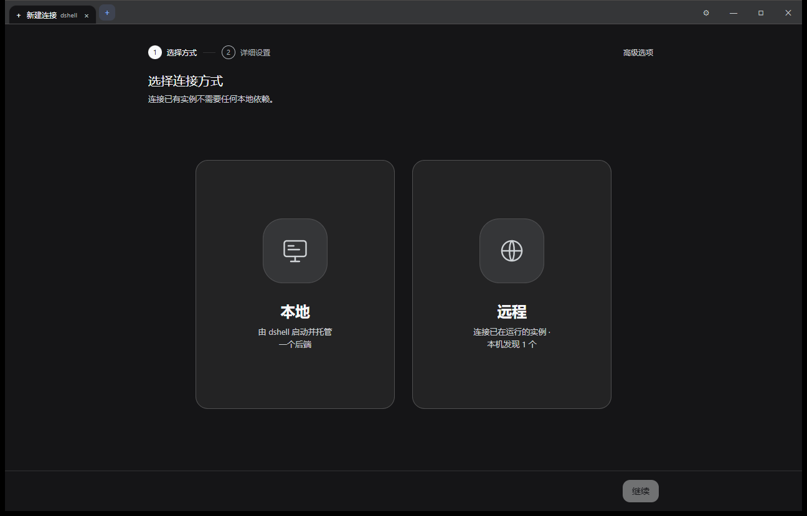

<div align="center">
  
  <h1>dshell</h1>
  <p><b>A desktop shell for DeepSeek Harness</b><br>
  One binary, one window, as many native DSH tabs as you need.</p>
  <p>
    <a href="../LICENSE"></a>
    
    
    
  </p>
  <p><a href="../README.md">简体中文</a> · English</p>
  <p>💙 Built on <a href="https://github.com/deepseek-ai/deepseek-harness">DeepSeek Harness</a>:
  the UI, the sessions and the whale are all DSH — dshell only adds a window around them.</p>
</div>

---



<p align="center"><sub><b>New connection</b> — let dshell start a local backend, or attach to a DSH instance that is already running.</sub></p>

## Why

`dsh web` is already a complete web app; what it lacks is a decent desktop window. dshell is that window, and nothing more:

- It does **not** rewrite DSH's chat, sessions, approvals or terminal — every tab loads the official frontend.
- It does **not** inject scripts or patch DSH, so a DSH upgrade never has to wait for dshell.
- It is **not another client** — no agent logic of its own, and it never touches model credentials.

dshell only does three things: **start or attach `dsh web`, capture the launch token, and arrange instances as tabs**.

## Features

- **One binary** — a single `dshell.exe` (~4 MB). Copy it and run; no installer, no bundled Node.
- **One window, many sessions** — each tab is an independent DSH instance (locally started or remotely attached). Sessions, approvals and terminals stay independent. Closing a tab ends its backend by default; the advanced options can keep it alive.
- **100% native UI** — no rewrite, no injection; the tab is DSH itself.
- **Credentials never pass through dshell** — the launch token appears in memory once, then the webview redeems and holds the cookie itself.
- **Connection first** — attaching to a local or remote instance needs no Node. dshell scans for instances already running on this machine, remembers recent connections, and lets you pin the ones you use.
- **Browser-style tabs** — `Ctrl+T` new, `Ctrl+W` close, `Ctrl+Tab` cycle, drag to reorder, double-click to rename, middle-click to close.
- **Follows the DSH theme** — the tab strip switches between light and dark with the active DSH page.
- **Your data stays yours** — dshell's config, runtimes and webview storage live in one data root; `DSH_HOME` is left untouched by default, so existing history, settings and API keys keep working.

> By default, DSH content pages ignore Windows' "reduce motion" setting so that
> working indicators such as the in-progress ring keep animating (dshell's own
> pages still follow the system setting). Turn this off in **Settings →
> Preferences → Keep DSH content animations playing**. New tabs pick up the
> change immediately; open tabs update after restarting dshell.

## Getting started

### Run it

Get `dshell.exe` from [Releases](https://github.com/Sturmfy/dshell/releases) — or [build it from source](#build-from-source) — and double-click it. The first launch opens a wizard: choose a data location → check the environment → create a connection.

Windows 10/11 and the WebView2 Runtime are required (usually already present). Attaching needs no Node; only "start local" via npx does.

> The in-app UI is currently in Simplified Chinese. This English README documents the same application.

### Where dshell keeps its data

The data root has a four-level fallback; the settings page always shows which level won:

| Priority | Location |
|---|---|
| 1 | `--data-root <path>` |
| 2 | `$DSHELL_HOME` |
| 3 | `<directory containing dshell.exe>\dshell-data\` |
| 4 | `%LOCALAPPDATA%\dshell\` |

This holds dshell's config, downloaded runtimes and per-instance webview storage. DSH's own `~/.dsh` (sessions, settings, credentials) is untouched by default.

### Build from source

Rust ≥ 1.90 with MSVC Build Tools, Node ≥ 20 (build only), and the WebView2 Runtime.

```powershell
npm install        # esbuild / typescript / @tauri-apps/api
npm run build      # build the UI + release binary
npm run binary     # stage release/dshell.exe and assert it is a single file
npm run app        # run in development mode
npm test           # Rust unit tests
npm run check      # clippy -D warnings
npm run icons      # logo-tile.svg → PNG → icon.ico (needs local Chrome/Edge)
```

### Keyboard shortcuts

| Shortcut | Action |
|---|---|
| `Ctrl+T` | New connection |
| `Ctrl+W` | Close the current tab |
| `Ctrl+Tab` / `Ctrl+Shift+Tab` | Next / previous tab |
| `Ctrl+1` … `Ctrl+9` | Jump to tab N (`Ctrl+9` is the last tab) |
| `Ctrl+R` | Reload the current tab |
| `Ctrl+,` | Open settings |
| Double-click a tab | Rename it (except dshell's own page tabs) |
| Middle-click a tab | Close it |

### Debugging

```powershell
$env:DSHELL_DEBUG='1'
.\dshell.exe --data-root E:\tmp\dshell-data
# → <data root>\logs\dshell-debug.log
```

## Scope

- Windows 10/11 only. The architecture does not preclude other platforms, but the first release is verified on Windows alone.
- No bundled Node and no model credentials handled by dshell; API keys stay in DSH's own settings.
- dshell never reads `~/.dsh/.credentials.yaml` to mint cookies.
- "Start local" via npx downloads the official distribution on first use (~450 MB); later launches use the cache.
- No auto-update in the first release.

## Documentation

- [中文 README](../README.md) — the same guide in Simplified Chinese.
- [ARCHITECTURE.md](../ARCHITECTURE.md) — the multi-webview window model, authentication boundary, process lifecycle and failure modes.

## License

MIT © 2026 Sturmfy — see [LICENSE](../LICENSE).
